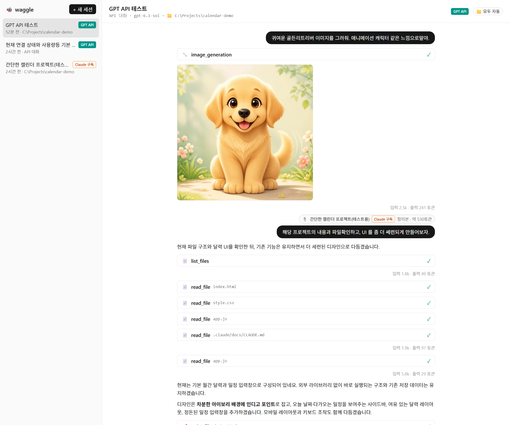
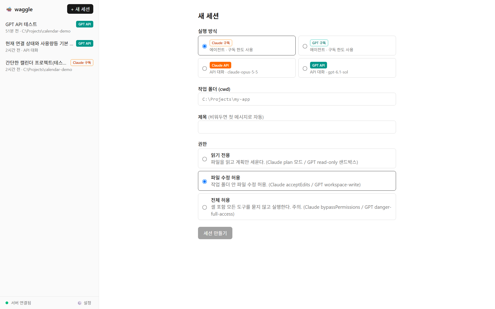
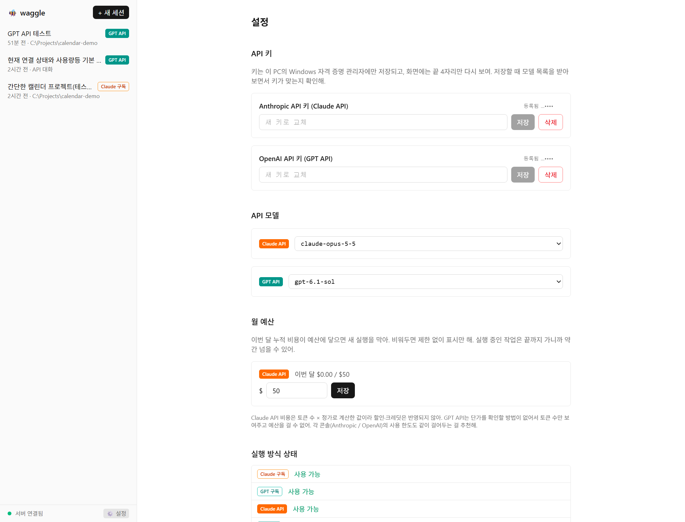

# 🐝 waggle

English | **[한국어](README.md)**

A local web app that puts Claude and GPT — **both subscription (CLI agents) and API** — in one screen, and lets **sessions pick up each other's context**.

Built for people who pay for both a Claude and a ChatGPT subscription but leave their separate API credits unused.
The goal: keep the subscriptions and the credits both working.

> The name comes from the honeybee's waggle dance: bees tell each other where the flowers are, and waggle sessions share what they've learned.

> [!CAUTION]
> **waggle is for use on your own machine only. Never expose it to a network.**
> The current version has no login or authentication. Anyone who can reach it can run shell commands through the agents on your machine, read and modify your files, and spend your subscriptions and API keys.
> **Do not** put it behind Tailscale (Serve/Funnel), ngrok, Cloudflare Tunnel, a reverse proxy, or router port forwarding. Changing the bind address or Origin settings to allow outside access is just as dangerous. (The server refuses to start if `WAGGLE_WEB_ORIGINS` contains a non-local address.)
> Authenticated remote access is being prepared for a [future update](#current-version-and-whats-next).



## Features

### Four ways to run
| Mode | How it runs | What it can do |
|---|---|---|
| Claude subscription | Your local Claude Code CLI | Read/edit files and run shell commands in a working folder |
| GPT subscription | Your local Codex CLI | Read/edit files and run shell commands in a working folder |
| Claude API | Anthropic Messages API | Chat, file work in a connected folder |
| GPT API | OpenAI Responses API | Chat, **image generation**, file work in a connected folder |



### Cross-session context sharing
- Attach another session's conversation — including one from the other vendor's model — with the 📎 button.
- It is not an AI summary. waggle mechanically keeps **only the questions and final answers**, so nothing gets distorted. In our measurements this was 1–13% of the original log size.
- Optionally include the tool steps (which files were read or edited).
- Attachments that cross vendors (Claude ↔ GPT) ask for confirmation before sending.

### Folder access with approval in API mode
- Connect a folder to an API session and the model can list, read, and edit files.
- The model only **requests** tool calls. The local server executes them.
  - Paths outside the connected folder are blocked (`../`, absolute paths, symlink/junction escapes).
  - Edits show a diff and wait for your approval.
  - Approval policy is per session: confirm edits only / confirm everything / fully automatic.
- API mode never runs shell commands.

### Also
- 📄 Attach text files
- API keys live in the OS credential store (Windows Credential Manager). Only the last 4 characters are ever shown.
- Pick models from the list your account can actually use.
- Monthly budget cap for the Claude API
  - Once this month's spend reaches the budget, new messages and new sessions are blocked.
  - When a single message calls the API many times (for example, folder work), waggle **re-checks before each next call and stops right there** if the budget is exceeded. File work already done stays recorded, so you can continue after adjusting the budget.
  - Cost is computed as tokens × list price. If a model with an unknown price answers, it's counted at the highest Opus price, so spend is never under-counted.
  - One in-flight response, or another session running at the same time, can still push slightly past the cap. Use it together with your console spending limits.
- Rename/delete sessions, conversation history stored locally (survives server restarts)
- Interface language: English / 한국어 (switch with the EN·KO button at the bottom of the sidebar, or in Settings)



## Quick start

See the **[setup guide](docs/SETUP.en.md)** for installation and account setup.

```bash
git clone https://github.com/SID9-HoneyBee/honeybee-waggle.git
cd honeybee-waggle
pnpm install
pnpm build
pnpm start
```

Open http://127.0.0.1:3000 in your browser.

## Before you use it

### Terms of service
- waggle only runs the Claude Code and Codex CLIs **installed on your own machine and logged in with your own account**. It is not a way to share a subscription with anyone else.
- You are responsible for complying with Anthropic's and OpenAI's terms and usage policies. Please review them before use.

### Security
- **The current version does not support remote access.** There is no login or authentication, so the moment it becomes reachable from outside, your whole machine is at risk.
  - Don't change the bind address (`127.0.0.1`) or add external addresses to `WAGGLE_WEB_ORIGINS`. That setting exists only for changing local ports.
  - Don't connect it to tools that relay a local port to the outside, such as Tailscale (Serve/Funnel), ngrok, Cloudflare Tunnel, reverse proxies, or port forwarding. Even though the server listens only on `127.0.0.1`, these tools bypass that restriction entirely.
- The server listens on `127.0.0.1` only and rejects connections from other websites (Origin check). It does **not** block other programs running on the same machine. Use it only on a machine you trust.
- The **"full access"** permission for subscription sessions lets the agent run shell commands without asking. Use it only when you really need it.
- API usage is billed for real. **Set spending limits** in the Anthropic and OpenAI consoles. waggle's monthly budget cap currently applies to the Claude API only.

## Current version and what's next

The current version is developed and used on Windows. The next updates aim to improve:

- Mac compatibility checks and fixes
- Attachments beyond text files, such as images
- A monthly budget cap for the GPT API as well
- A distribution package that makes installing and running easier
- **Authenticated remote access**: the plan is to let you direct work from other devices, such as your phone. The order matters:
  1. First, authentication (tokens, passkeys) and a configurable Origin allowlist
  2. Then, access over private networks such as Tailscale

  Until then, external exposure stays blocked. (See the caution above.)

The goal is to make choosing between subscription and API on your own machine, and carrying context across sessions, even smoother.

## Layout

```
apps/server     Node + TypeScript. CLI/API adapters, session storage, WebSocket server
apps/web        Next.js. Session list, chat, and settings screens
packages/schema Adapter schema and protocol types shared by server and web
```

Conversation history and settings are stored in `.data/` (git-ignored).

## License

[MIT](LICENSE)
