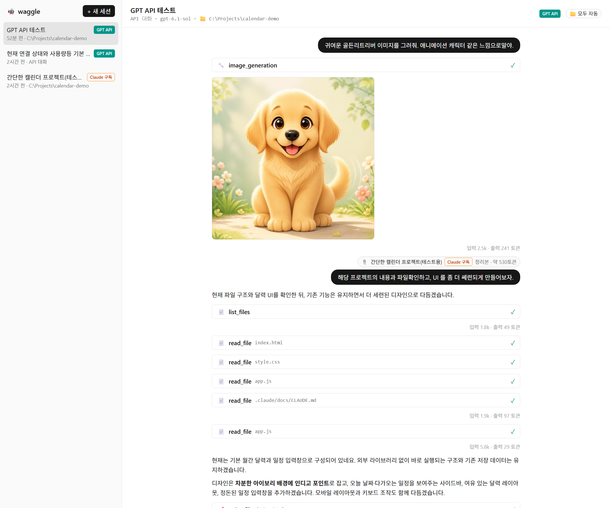
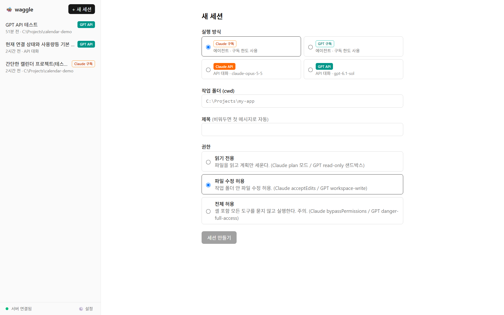
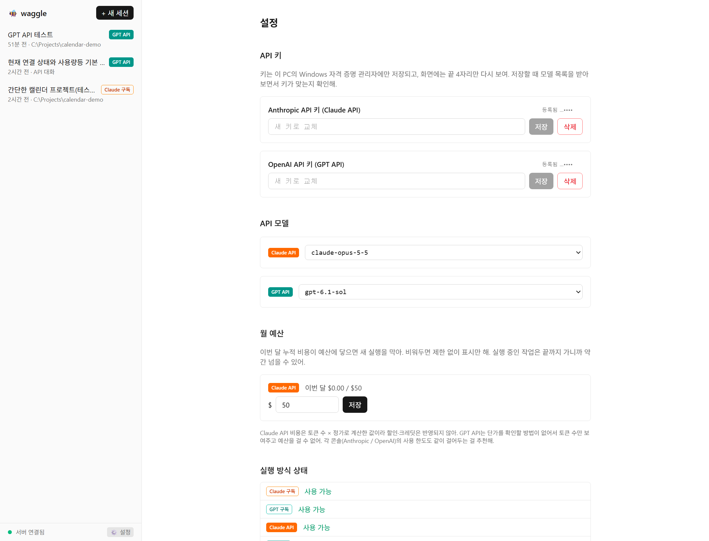

# 🐝 waggle

**[English](README.en.md)** | 한국어

Claude와 GPT를 **구독(CLI 에이전트)과 API로 한 화면에서** 쓰고, **서로의 세션 내용을 이어받아** 작업하는 로컬 웹앱입니다.

Claude 구독과 ChatGPT 구독을 둘 다 쓰면서 따로 받은 API 크레딧은 묵히고 있는 경우를 위해 만들었습니다.
구독은 구독대로, 크레딧은 크레딧대로 놀리지 않고 쓰는 게 목표입니다.

> 이름은 꿀벌의 8자 춤(waggle dance)에서 따왔습니다. 꿀벌이 춤으로 꽃 위치를 동료에게 알려주듯, 세션끼리 알게 된 내용을 나눕니다.



## 주요 기능

### 4가지 실행 방식
| 방식 | 동작 | 할 수 있는 것 |
|---|---|---|
| Claude 구독 | 내 PC의 Claude Code CLI 실행 | 작업 폴더에서 파일 읽기·수정·셸 실행 |
| GPT 구독 | 내 PC의 Codex CLI 실행 | 작업 폴더에서 파일 읽기·수정·셸 실행 |
| Claude API | Anthropic Messages API 직접 호출 | 대화, 연결한 폴더의 파일 작업 |
| GPT API | OpenAI Responses API 직접 호출 | 대화, **이미지 생성**, 연결한 폴더의 파일 작업 |



### 세션 간 내용 공유
- 📎 버튼으로 다른 세션(다른 회사 모델 포함)의 대화를 메시지에 첨부합니다.
- AI 요약이 아니라 **질문과 최종 답변만 기계적으로 추린 정리본**이라 내용이 왜곡되지 않습니다. 실제 측정에서 원본 기록의 1~13% 크기였습니다.
- 필요하면 도구 사용 과정(어떤 파일을 읽고 고쳤는지)도 포함할 수 있습니다.
- Claude ↔ GPT처럼 회사가 바뀌는 첨부는 전송 전에 확인합니다.

### API 모드의 폴더 연결과 승인
- API 세션에 폴더를 연결하면 모델이 파일 목록·읽기·수정 도구를 쓸 수 있습니다.
- 모델은 도구를 **요청만** 하고, 실행은 로컬 서버가 합니다.
  - 연결한 폴더 밖 경로는 차단합니다 (`../`, 절대 경로, 심볼릭 링크·정션 우회 포함).
  - 수정 전에 변경 내용(diff)을 보여주고 승인을 받습니다.
  - 승인 방식은 세션마다 고릅니다: 수정만 확인 / 매번 확인 / 모두 자동
- API 모드에서는 셸 명령을 실행하지 않습니다.

### 그 밖에
- 📄 텍스트 파일 첨부
- API 키는 OS 자격 증명 저장소(Windows 자격 증명 관리자)에 저장하고, 화면에는 끝 4자리만 표시합니다.
- 내 계정에서 실제로 쓸 수 있는 모델 목록에서 모델을 고릅니다.
- Claude API 월 예산 상한 (토큰 × 정가로 계산)
- 세션 제목 변경·삭제, 대화 기록 로컬 저장 (서버를 재시작해도 유지)



## 빠른 시작

자세한 설치와 계정 등록 방법은 **[설치 가이드](docs/SETUP.md)** 를 보세요.

```bash
git clone https://github.com/SID9-HoneyBee/honeybee-waggle.git
cd honeybee-waggle
pnpm install
pnpm build
pnpm start
```

브라우저에서 http://127.0.0.1:3000 을 엽니다.

## 꼭 알아두세요

### 이용 약관
- waggle은 **사용자 본인의 PC에 설치되고 본인이 로그인한** Claude Code·Codex CLI를 실행할 뿐입니다. 구독을 다른 사람과 나눠 쓰게 해주는 도구가 아닙니다.
- Anthropic·OpenAI 서비스 약관과 사용 정책 준수는 사용자 책임입니다. 사용 전에 각 약관을 확인하세요.

### 보안
- 서버는 `127.0.0.1`에서만 열리고, 다른 웹사이트에서의 접속(Origin)을 막습니다. 다만 **같은 PC에서 실행되는 다른 프로그램의 접속은 막지 않습니다.** 신뢰할 수 있는 PC에서만 쓰세요.
- 구독 세션의 **"전체 허용"** 권한은 에이전트가 묻지 않고 셸 명령까지 실행합니다. 꼭 필요할 때만 쓰세요.
- API 비용이 실제로 청구됩니다. 각 콘솔(Anthropic / OpenAI)에서 **사용 한도를 꼭 설정**하세요. GPT API는 비용을 계산할 수 없어 waggle에서 예산을 걸 수 없습니다.

### 한계
- 1인용 로컬 도구입니다. 원격 접속과 다중 사용자는 지원하지 않습니다.
- **Windows에서만 테스트했습니다.** macOS·Linux는 동작할 수 있지만 확인하지 않았습니다.
- 첨부는 텍스트 파일만 됩니다 (이미지 첨부 미지원).
- 자동화된 테스트가 없습니다. 개인 프로젝트 수준이라는 점을 감안해주세요.

## 구조

```
apps/server    Node + TypeScript. CLI 실행·API 호출 어댑터, 세션 저장, WebSocket 서버
apps/web       Next.js. 세션 목록·채팅·설정 화면
packages/schema 서버와 웹이 공유하는 어댑터 스키마·프로토콜 타입
```

대화 기록과 설정은 `.data/` 폴더에 저장됩니다 (git 제외).

## 라이선스

[MIT](LICENSE)
